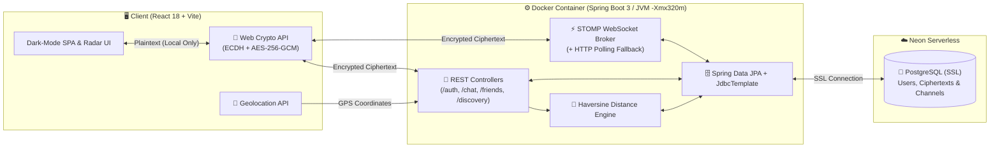
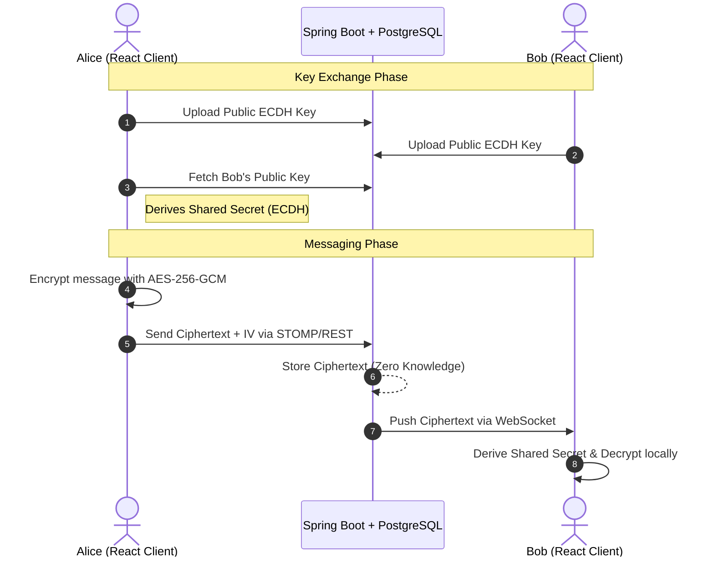

# 🔒 CipherChat: Zero-Phone End-to-End Encrypted (E2EE) Chat System

CipherChat is a modern, privacy-first communication platform that operates without requiring phone numbers, SIM cards, or centralized identity linkage. Built with **Java Spring Boot**, **React (Vite)**, and **WebSockets**, it provides high-security peer-to-peer style messaging, group circles, and open communities with full client-side encryption and admin moderation workflows.

## ✨ Core Features

### 🔐 Security & Zero-Knowledge Privacy
* **Anonymous Onboarding:** Sign up with just a username, passphrase, and custom security question—no phone number or email required.
* **Client-Side E2EE:** Derives shared secrets locally via **Web Crypto API (`ECDH` + `AES-256-GCM`)**; private keys never leave your device.
* **Granular Message Deletion:** Choose **Delete for Me** (local hide) or **Delete for Everyone** (permanent database wipe + live screen sync).

### 📡 Location Radar & Discovery
* **GPS Node Explorer:** Discovers nearby users using the Browser Geolocation API and server-side **Haversine** distance math.
* **Radar Visible vs. Ghost Mode:** Toggle public proximity visibility on or off anytime without interrupting active friend chats.
* **Open DMs vs. Friends Only:** Accept instant messages from nearby users with a one-click **Send Friend Request** banner, or lock DMs to approved friends only.

### 💬 Rich Real-Time Messaging
* **Encrypted Multimedia:** Send E2EE text, images, files, and voice notes with live typing indicators and online presence.
* **Personalization & Local Time:** Customize chat themes, wallpapers, and profile avatars, with automatic UTC-to-local device timestamp conversion.

### 🛡️ Social & Community Moderation
* **User & Group Controls:** Manage **Friends**, **Blocked Users**, and **Communities** with join approvals, member moderation, and **Admin Delete**.


## 🏗️ System Architecture


<details>
<summary><b>🔐 View End-to-End Encryption (E2EE) Message Flow</b></summary>



</details>

## 📂 Project Structure

```text
Numberless fully - encrypted - based Chat system/
├── backend/
│   ├── src/main/java/com/cipherchat/
│   │   ├── config/          # WebSocket, CORS, and Security configurations
│   │   ├── controller/      # Auth, Chat, Channel, and Friend REST/WS controllers
│   │   ├── model/           # JPA Entities (User, Friendship, ChatChannel, EncryptedMessage)
│   │   └── repository/      # Spring Data JPA Repositories
│   └── pom.xml              # Maven build configuration
├── frontend/
│   ├── src/
│   │   ├── components/      # ChatWindow, RadarView, and UI layouts
│   │   ├── crypto/          # WebCrypto AES-256-GCM cipher engine
│   │   ├── services/        # Axios API and STOMP WebSocket client services
│   │   ├── App.jsx          # Main application router and state manager
│   │   └── main.jsx         # React entry point with ErrorBoundary
│   └── vite.config.js       # Vite build & proxy configurations
├── Dockerfile               # Multi-stage production container build
└── README.md                # Project documentation
```
## 🚀 How to Use CipherChat

Follow this quick guide to get started with **CipherChat**—no phone number or email required.

---

### 1. 🔐 Create Your Anonymous Identity
1. Open the application and switch to the **Register** tab.
2. Enter a unique **Username** and a strong **Passphrase**.
3. *(Optional)* Add a custom **Security Question & Answer** so you can recover your account later without a phone number.
4. Click **Register**. Your browser automatically generates a local **ECDH / AES-256-GCM** encryption keypair—your private key never leaves your device.

> **Note:** Returning users must log in with their registered credentials. Unregistered usernames or incorrect passphrases are blocked with an on-screen alert.

---

### 2. 🛡️ Configure Your Privacy Controls
Right from the left sidebar, toggle two real-time privacy switches anytime:

| Control | Mode A | Mode B |
| :--- | :--- | :--- |
| **Visibility** | **👁️ Radar Visible** — Appear on nearby users' GPS Radar with approximate distance. | **👻 Ghost Mode** — Instantly hide your profile from everyone's Radar. |
| **Messaging** | **🌐 Open DMs** — Anyone who finds you on Radar can message you immediately. | **🔒 Friends Only** — Strangers must send a friend request and wait for acceptance. |

---

### 3. 🧭 Discover People, Groups & Communities
* **GPS Radar (Compass Icon):** Click the **Compass** icon to open the **Encrypted Node Explorer**. Allow location access to scan nearby discoverable users (with live distance) and browse public **Groups & Communities**.
* **Direct Search:** Use the **Search friend by username...** bar in the sidebar to locate a specific user and send a friend request.
* **Create a Space:** Switch to the **Groups** or **Communities** tab in the sidebar to create your own public or private channel.

---

### 4. 💬 Start Encrypted Conversations
* **Direct Messages:** Click any accepted friend in your **Personal** list to chat.
* **Open DM Threads:** If you message an **Open DM** user from Radar without being friends, the chat opens immediately for both users with an **Open DM banner** and a one-click **Send Friend Request** button.
* **Rich Media:** Send encrypted text, images, file attachments, and voice notes directly from the chat input bar.
* **Message Deletion:** Hover over any message and click the **Trash (🗑️)** icon to choose:
  * **Delete for Me** — Removes the message from your screen only.
  * **Delete for Everyone** — Permanently erases the message for all participants.

---

### 5. ⚙️ Manage Contacts, Groups & Profile
* **Unfriend or Block:** Open any DM, click the top-right **`⋮`** menu, and select **Unfriend** or **Block User**. Blocked contacts are moved to the **Blocked List (🛡️)** tab, where you can unblock them anytime.
* **Group Admin Controls:** Group and Community creators can approve/reject join requests, edit channel details, remove/block members, or permanently **Delete** the channel.
* **Profile & Themes:** Click the bottom-left **Settings (⚙️)** button to update your **Display Name**, upload a **Profile Picture**, or switch your **Chat Wallpaper & Theme**.

## ⚡ Quick Start (Run Locally)

### Prerequisites
Make sure you have the following installed:
* **Java 17+** & **Maven 3.9+**
* **Node.js 18+** & **npm**
* A **PostgreSQL** database (e.g., [Neon](https://neon.tech/) free tier or local PostgreSQL)

---

### 1. Clone the Repository
```bash
git clone <your-repository-url>
cd "Numberless fully - encrypted - based Chat system"
```

### 2. Configure Database Credentials
Set your PostgreSQL connection details in backend/src/main/resources/application.properties (or export them as environment variables):
```bash
spring.datasource.url=jdbc:postgresql://<your-neon-host>/<dbname>?sslmode=require
spring.datasource.username=<your-db-username>
spring.datasource.password=<your-db-password>
```
### 3. Start the Backend (Spring Boot)
Open a terminal in the project root:
```bash
cd backend
mvn clean spring-boot:run
```
> [!IMPORTANT]
> Backend runs at.. `http://localhost:8080`

### 4. Start the Frontend (React + Vite)

Open a **second terminal** in the project root:

```bash
cd frontend
npm install
npm run dev
```
> [!TIP]
> Frontend runs at `http://localhost:5173` — open this URL in your browser to start chatting!

### 🐳 Run with Docker (Single Command)
If you have **Docker** installed, you can build and run the entire full-stack app (Frontend + Backend combined) in one container:
```bash
# 1. Build the image
docker build -t cipherchat .

# 2. Run the container
docker run -p 8080:8080 \
  -e SPRING_DATASOURCE_URL="jdbc:postgresql://<your-neon-host>/<dbname>?sslmode=require" \
  -e SPRING_DATASOURCE_USERNAME="<your-db-username>" \
  -e SPRING_DATASOURCE_PASSWORD="<your-db-password>" \
  cipherchat
```
> [!NOTE]
> Access the full app at `http://localhost:8080`

